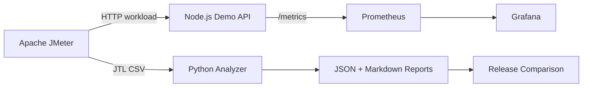

# Performance & Load Testing Platform

[](https://github.com/shehzadres/performance-load-testing-platform/actions/workflows/ci.yml) [](https://shehzadres.github.io/performance-load-testing-platform/)

A reproducible local performance-engineering lab built with Apache JMeter, Docker Compose, Node.js, Prometheus, Grafana and Python.

> **Evidence policy:** benchmark numbers are generated only by real JMeter runs against the local demo API. No illustrative or synthetic fixture data is presented as measured performance.

## What this project demonstrates

- Baseline, load and stress testing with configurable virtual users.
- API response validation and request journeys.
- p50, p90, p95 and p99 latency, throughput and error-rate analysis.
- Prometheus instrumentation, Grafana dashboards and alert rules.
- Per-run raw JTL, JSON summaries and Markdown reports.
- Controlled baseline-versus-candidate comparisons.

## Architecture



See [Architecture](docs/ARCHITECTURE.md), [Test Strategy](docs/TEST_STRATEGY.md), [Project Guide](docs/PROJECT_GUIDE.md) and [Bottleneck Analysis](docs/BOTTLENECK_ANALYSIS.md).

## Prerequisites

- Windows 10/11 or Linux/macOS with Docker Desktop / Docker Engine and Docker Compose.
- Python 3.10+.
- Node.js 20+ only if running API tests directly on the host.
- Internet access for the initial Docker image pulls.

JMeter runs inside its pinned Docker image. A local JMeter installation is not required.

## Quick start (PowerShell)

```powershell
.\scripts\start-platform.ps1
.\scripts\run-test.ps1 -Users 2 -RampUp 1 -Duration 10 -Label smoke
.\scripts\analyze-results.ps1
```

Open:
- API health: http://localhost:18080/health
- Prometheus: http://localhost:9090
- Grafana: http://localhost:3000

Grafana's local lab credentials default to `admin / admin`. Change them before exposing Grafana beyond localhost. This stack is intended for local use only.

## Test profiles

| Profile | Virtual users | Duration | Purpose |
|---|---:|---:|---|
| Smoke | 2 | 10 sec | Verify the test path |
| Baseline | 10 | 60 sec | Establish a reference |
| Load | 25 | 120 sec | Exercise expected load |
| Stress | 50 | 90 sec | Explore degradation |

Run baseline and stress:

```powershell
.\scripts\run-baseline.ps1
.\scripts\run-stress.ps1
```

Custom run:

```powershell
.\scripts\run-test.ps1 -Users 25 -RampUp 15 -Duration 120 -Label release-1.1
```

Each run produces:
- `results/<run-id>.jtl`: raw JMeter CSV evidence.
- `results/<run-id>.json`: machine-readable metrics.
- `reports/<run-id>.md`: readable run report.

Compare two runs:

```powershell
.\scripts\compare-releases.ps1 -Baseline <baseline-run-id> -Candidate <candidate-run-id>
```

## Measured local results

These are actual JMeter runs against the local demo API on 12 November 2026. Transaction Controller samples are reported separately and excluded from HTTP request throughput to avoid double-counting.

| Scenario | Virtual users | Duration | Request samples | Throughput | p95 latency | Error rate |
|---|---:|---:|---:|---:|---:|---:|
| Smoke | 2 | 10 sec | 403 | 40.312 req/s | 127 ms | 0% |
| Baseline | 10 | 60 sec | 11,191 | 186.265 req/s | 130 ms | 0% |
| Stress | 50 | 90 sec | 59,533 | 659.331 req/s | 183 ms | 0% |
| Baseline repeat | 10 | 60 sec | 11,701 | 194.971 req/s | 130 ms | 0% |

**Execution environment:** Dell Latitude 7420, Intel Core i7-1185G7 (4 cores / 8 threads), 15.73 GiB RAM, Windows 11 Pro, Docker Engine 29.5.3, Docker Compose 5.1.4 and JMeter 5.6.3.

The stress run delivered approximately 3.54× baseline throughput while p95 latency increased by approximately 40.8%; no failed HTTP samples were recorded. These figures describe this machine, test plan and synthetic API only. They are not universal capacity claims or production SLOs.

Curated raw JTL files, JSON summaries and Markdown reports are stored in [local execution evidence](evidence/local-runs/). The separate GitHub-hosted CI smoke run recorded 437 requests, 43.556 req/s, 123 ms p95 and 0% errors; its raw evidence is in evidence/ci-smoke/. Hosted-runner figures are not mixed with local laptop measurements.

## API under test

| Method | Endpoint | Purpose |
|---|---|---|
| GET | `/health` | Health and version |
| GET | `/api/products` | Product listing |
| GET | `/api/search` | Configurable I/O delay |
| GET | `/api/report` | Configurable I/O and bounded CPU work |
| POST | `/api/checkout` | JSON request handling |
| GET | `/metrics` | Prometheus metrics |

## Recruiter showcase

[Open the live recruiter showcase](https://shehzadres.github.io/performance-load-testing-platform/). GitHub Actions publishes it after the Docker + JMeter smoke integration passes. Source: `showcase/index.html`. The page reads a real run summary generated by the CI smoke test and never invents benchmark values.

## Repository structure

```text
app/                 Instrumented Node.js API and API tests
analysis/            JTL analysis and release comparison
jmeter/              JMeter test plan
monitoring/          Prometheus, alert rules and Grafana provisioning
scripts/             PowerShell operator scripts
docs/                Architecture, strategy, execution and interview docs
evidence/            Curated local and CI JTL/report evidence
showcase/            Recruiter-facing visual project page
results/             Generated JTL and JSON evidence (raw JTL ignored by Git)
reports/             Generated Markdown reports
.github/workflows/   Continuous integration
```

## Safety and scope

This project targets its own local demo API. Only run load or stress tests against systems you own or have explicit written authorization to test. Do not use the stress profile against public services.

This is a local engineering lab, not a production monitoring deployment. Docker host and JMeter capacity can become the bottleneck before the API. Record workload shape and machine resources when comparing runs.

## Current verification status

See [QA_REPORT.md](QA_REPORT.md) and [Execution Log](docs/EXECUTION_LOG.md) for the latest verified state. The repository distinguishes static checks, API tests and full runtime/load-test evidence.
